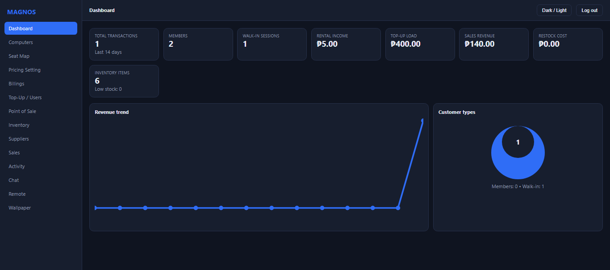
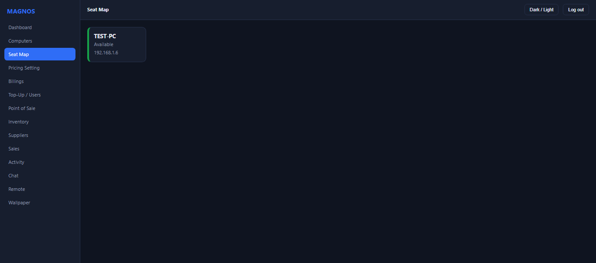
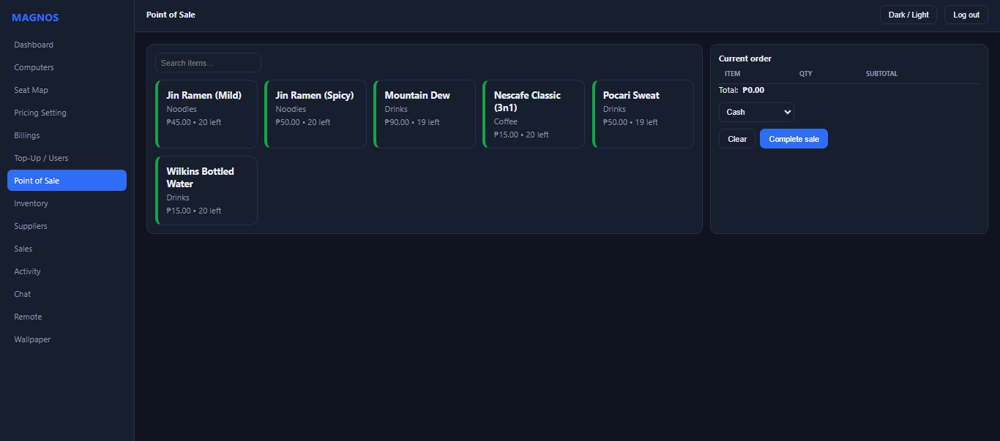
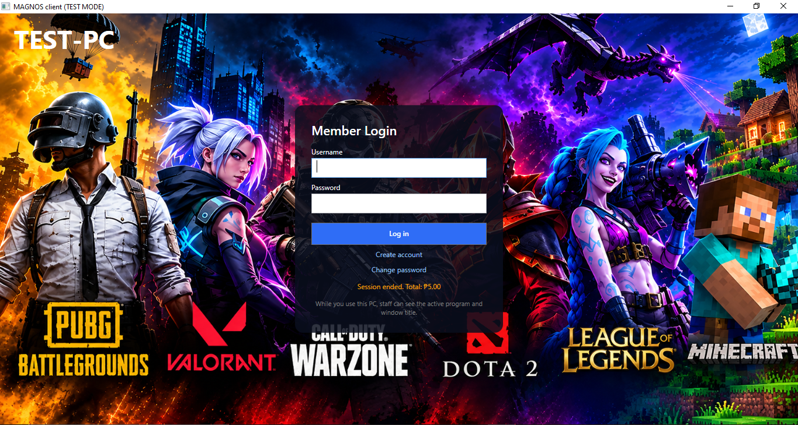
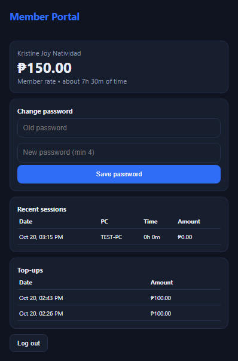

# MAGNOS

**Management And Governance Network Operations System**

*Monitor every machine. Manage every transaction. Monetize every minute.*

Free, open-source computer rental management, point of sale, and real-time monitoring for internet cafe and gaming shops, on Windows.

> Independent project, not affiliated with any commercial café-management product.

## What it does
A café owner installs the **server** on one PC and the **client** on every customer PC. Staff run the business from a web dashboard; customers get a lock screen and a timer; members check their balance from their phone.

| | |
|---|---|
|  |  |
|  |  |

## Features
- **Time and billing:** open time, set time, pause/resume, transfer to another PC; Walk-in / Member / VIP pricing; member wallets, top-ups, billing history.
- **Staff dashboard (web):** live PC list and seat map, remote lock / restart / shutdown / message, chat, activity view, charts, dark mode, mobile friendly.
- **Customer client:** full-screen lock screen, login and registration, session widget, chat with staff, change password, idle auto-shutdown, wallpaper sync.
- **Shop:** point of sale, inventory with low-stock alerts, suppliers, sales report.
- **Member portal** (`/portal/`): balance, time left, history, password change, optional Google sign-in.
- **Easy setup:** one script per PC; clients find the server automatically on the network.

## Tech stack
| Area | Technology |
|---|---|
| Server | C# / ASP.NET Core 8 (minimal APIs), Entity Framework Core, SQLite |
| Real time | SignalR (WebSockets) |
| Customer client | C# / WPF (.NET 8), Win32 keyboard hook |
| Dashboard and portal | Plain HTML, CSS, and JavaScript served by the server (no build step) |
| Security | BCrypt password hashing, API keys, rate limiting, least-privilege Windows account |
| Testing and CI | xUnit (about 40 tests), GitHub Actions |
| Packaging | Self-contained .NET publish, PowerShell installers, Windows service |

## Engineering highlights
- **The server is the source of truth for time and money.** Clients only display; they never decide what a session costs. ([why](docs/DECISIONS.md))
- **Money logic is covered by tests:** pricing rules, pro-rata time, wallet limits, pause handling, and double-billing protection.
- **Safe upgrades:** the server adds missing tables and columns to an existing database, and the installer keeps keys and data. Tested against an old database.
- **Defence in depth on the customer PC:** standard Windows account, read-only program folder, blocked shortcuts and tools, a watchdog that relaunches the client, and a protected staff exit. Limits are documented honestly.
- **Zero-config networking:** clients locate the server with a UDP broadcast and re-find it if its address changes.

Read more: [Architecture](docs/ARCHITECTURE.md) | [Design decisions and trade-offs](docs/DECISIONS.md) | [Roadmap](ROADMAP.md) | [Changelog](CHANGELOG.md)

## Quick start
Requirements: Windows 10 or 11 (64-bit), all PCs on the same local network. The packages include .NET.
Ports used: TCP 5000 (dashboard and clients) and UDP 5001 (automatic server detection); the installer opens them.

**1. Server PC** (PowerShell as Administrator, in the extracted server package):

    powershell -ExecutionPolicy Bypass -File install-server.ps1

It prints the dashboard address, an **admin key**, and a **client key**. Keep both private.

**2. Each customer PC** (PowerShell as Administrator, in the extracted client package):

    powershell -ExecutionPolicy Bypass -File install-client.ps1 -ClientKey YOUR_CLIENT_KEY -SetupCustomer

This finds the server, creates a standard **Customer** account, locks the program folder, applies restrictions, and starts the client for that account. Use `-TestMode` instead to try it without the full-screen lock.

**3. Staff:** open `http://SERVER-IP:5000`, log in with the admin key, add time for a customer.

Staff exit on a customer PC: **Ctrl + Shift + F12** on the lock screen, then the admin key.

## Build and test from source
Requires the .NET 8 SDK.

    dotnet test tests/Server.Tests/Server.Tests.csproj
    powershell -ExecutionPolicy Bypass -File build.ps1 -Version 0.1.0

The second command creates the two install packages in `release\`.

## Project layout
    server/             ASP.NET Core server, SQLite data, billing engine, dashboard (wwwroot)
    client/             WPF customer client (Core, Security, Ui, Native)
    tests/Server.Tests/ xUnit tests for pricing, billing, sessions, and schema upgrades
    installer/          install, uninstall, and customer-account setup scripts
    docs/               architecture, decisions, setup guides

## Privacy and safety
- Activity monitoring records only the **active program and window title** during a session, kept 14 days; no screenshots. Customers are told on the lock screen and in the widget. Check the privacy rules where you operate.
- The server uses plain HTTP on the local network. Do not expose it to the internet; see [SECURITY.md](SECURITY.md).
- Customers must use a Standard Windows account. The lock-down stops casual tampering, not a determined administrator.

Designed, tested, and maintained by **John Robert Pimentel**.

## License
MIT. See [LICENSE](LICENSE).

