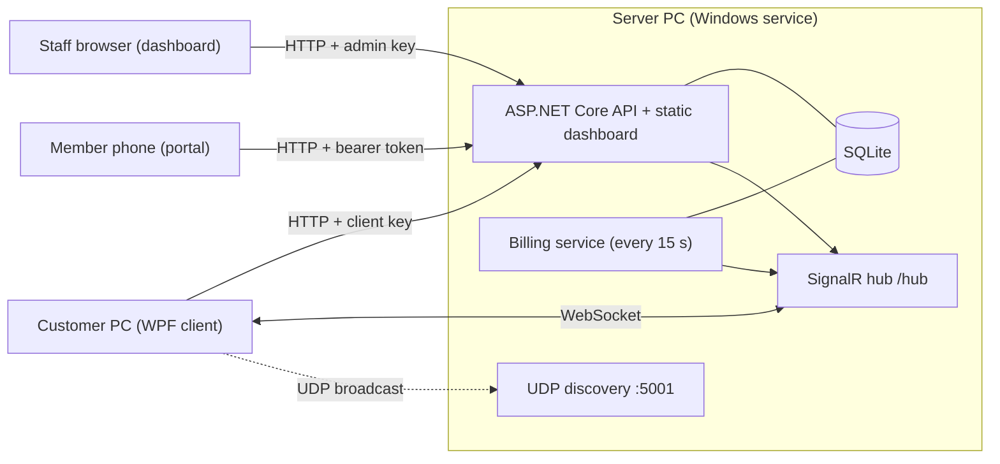
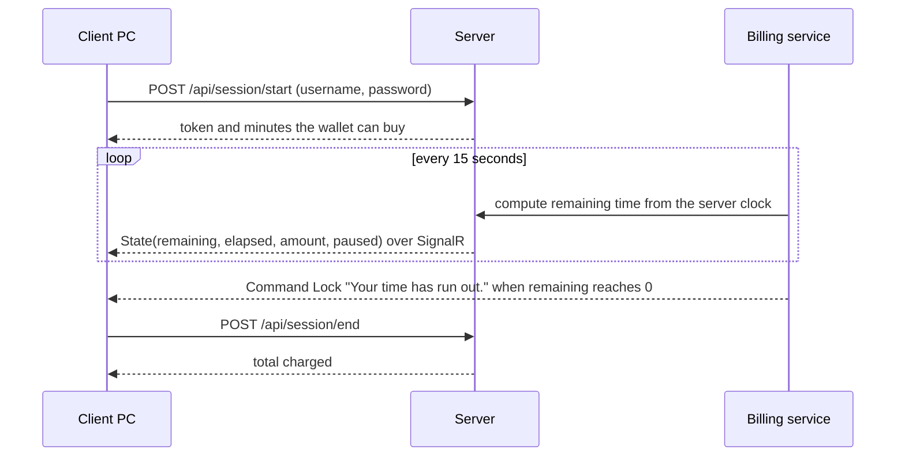
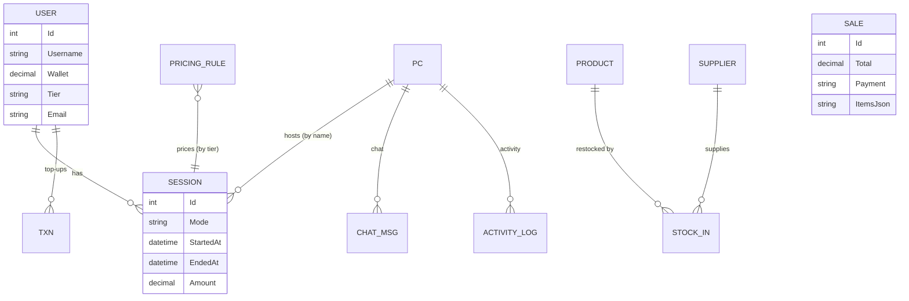

# Architecture

## Overview
One **server** owns all state (customers, sessions, money, stock). Everything else is a thin front end that talks to it.



## Who talks to whom
| Caller | Authenticates with | Used for |
|---|---|---|
| Staff dashboard | `X-Admin-Key` header | everything under `/api/admin/*` |
| Customer client | `X-Client-Key` header (shared secret) | register, start/end session, chat, activity, wallpaper |
| Customer client | same key as a query value | SignalR connection |
| Member portal | `Authorization: Bearer <token>` (12 h, in memory) | balance and history; optional Google sign-in |

## A session, step by step

Staff-started sessions (open time / set time) skip the login step: the dashboard calls the server, which sends `StartSession` to that PC over SignalR.

## Billing model
- A **pricing rule** is `(tier, minutes, price)`. Tiers: WalkIn, Member, VIP.
- `Engine.Price` applies the largest rules first, then charges leftover time pro-rata at the smallest rule's per-minute rate. Time is counted in whole minutes.
- Three session modes: **Open** (pay at the end), **Fixed** (prepaid, price stored at start), **Wallet** (member; charged to the wallet at the end, never below zero).
- `Engine.Affordable` converts a wallet balance into minutes (capped at 24 hours); the billing service locks the PC when a wallet or prepaid session hits zero.
- Pausing stores `PausedAt` and accumulates `PausedSeconds`; elapsed time excludes both.

## Data model


## Customer PC protection
Layers, from strongest to weakest:
1. Customers sign in to a **Standard Windows account** (cannot install software or edit protected folders).
2. The client folder is **read-only** for that account.
3. Per-user policies disable Task Manager, Run, Command Prompt, PowerShell, Registry Editor, and Control Panel.
4. A **low-level keyboard hook** blocks the Windows key, Alt+Tab, Alt+Esc, Alt+F4, Alt+Space, and Ctrl+Esc on the lock screen.
5. A **scheduled task** relaunches the client within a minute if it is closed; a mutex keeps a single instance.
6. **Staff exit**: Ctrl + Shift + F12 plus the admin key, verified by the server.

## Code map
```
server/
  Program.cs      HTTP endpoints (client, admin) and startup
  Extras.cs       inventory, POS, chat, activity, member portal, schema upgrader
  Engine.cs       pricing and time maths (pure, unit tested)
  Hub.cs          SignalR hub, Billing (settle/push), BillingService (15 s tick)
  Discovery.cs    UDP server discovery
  Models.cs       EF Core entities and DbContext
  wwwroot/        dashboard and member portal (plain JS)
client/
  Program.cs      entry point (single instance)
  Core/           Controller (connection, sessions, chat, activity), models
  Security/       lock-down policies, keyboard hook
  Ui/             lock screen, session widget, chat, dialogs, staff message
  Native/         foreground-window lookup
```
